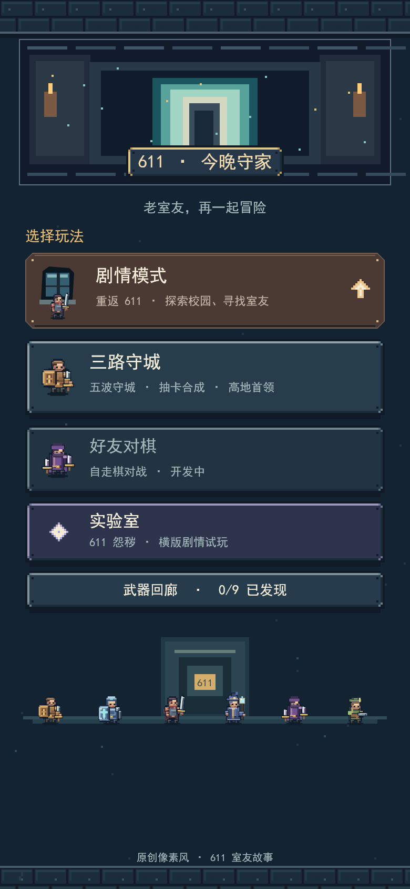
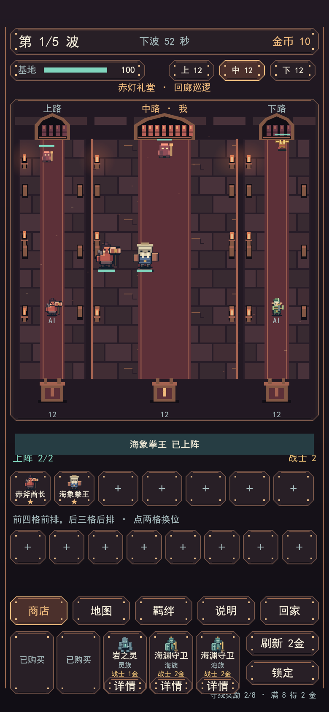
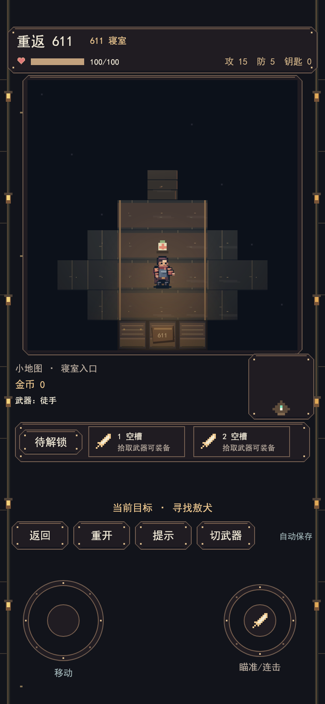
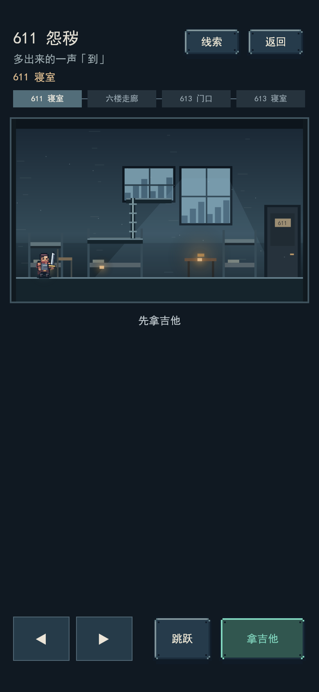

# 611 今晚守家

一款以大学宿舍为背景的原创像素风微信小游戏。可以抽卡布阵，和电脑队友一起守住 611，也可以扮演 CSY，在校园里寻找失踪的室友。

当前可试玩三路守城、单人剧情和实验室里的横版首关。好友对棋仍在开发，联机房间服务目前是独立原型。

## 游戏画面

以下图片由当前分支的小游戏代码离屏渲染，使用竖屏画布，画面内容来自游戏本身。

| 模式首页 | 三路守城 | 剧情模式 | 实验室 · 611 怨秽 |
| :---: | :---: | :---: | :---: |
|  |  |  |  |

## 怎么玩

### 三路守城

从首页进入「三路守城」，选择**赤灯礼堂**或**黑塔之巅**。一局共五波，左右两路初始由电脑队友防守。

1. **买卡和上阵。** 在商店点伙伴买入，选中备战区里的伙伴，再点空阵位或「上阵」。近战放前排，远程和辅助放后排。
2. **升星和凑羁绊。** 三个同名、同星级伙伴可以合成高一星的伙伴。「羁绊」页能查看种族、职业和 611 羁绊的进度。
3. **波间整备。** 利用准备时间调整站位、刷新商店，给上阵伙伴装备战意剑、冰霜符或电弧符。通过「地图」观察三路，必要时换路支援或回高地。
4. **守住高地。** 最后一波进入首领战。赤灯礼堂要留意治疗和复苏，黑塔之巅的首领升空时先处理两侧火灵。

想快速体验支援，可以在副本选择页进入「3 分钟救场」。敖犬默认上阵，再选唐卵清怪群，或选红星处理漏网怪。

### 剧情模式 · 重返 611

用摇杆在寝室和校园场景中移动。靠近 NPC、武器或机关时，按画面提示互动。调查线索、解开机关、寻找室友，再继续推进。换武器会改变手持造型和攻击方式，已经发现的武器可在首页「武器回廊」查看。

### 实验室 · 611 怨秽

从首页点「实验室」→「进入试玩」。第一关叫**《多出来的一声「到」》**。CSY 宿醉醒来，发现寝室空了，带上吉他去 613 找人。用左右键、跳跃和情境互动探索，攀管翻窗，借灯光找路，再观察影子躲开怪物扑击。每个区域以完整侧视画面呈现，顶部小地图显示楼层路线。退出再进入时，可以从最近进入的区域继续。

## 在微信开发者工具运行

1. 克隆仓库，检出 `experiment/lane-defense` 分支。
2. 打开微信开发者工具，选择「小游戏」→「导入」，目录选克隆下来的仓库根目录。小游戏代码位于 `minigame/`。
3. 选择自己有开发权限的小游戏 AppID，或使用工具提供的可用小游戏测试号。导入后点「编译」，再从首页选择模式。

更多细节可查看 [玩法记录](docs/gameplay.md)、[试玩说明](docs/试玩说明.md)和[联机房间原型](docs/联机房间原型.md)。
